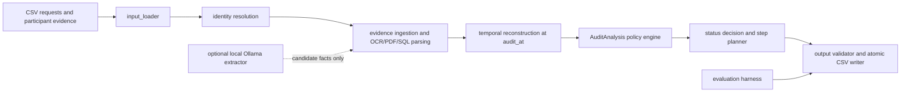

<div align="center">
  
# HackerRank Orchestrate Oct 2026

## Ghost Data Still Exists

**A safety-first, evidence-grounded deletion audit agent**

[Overview](#overview) · [Architecture](#architecture) · [Quick start](#quick-start) · [Results](#measured-results)

</div>

> **Attribution:** the problem statement and dataset were provided by HackerRank as
> part of the October 2026 Orchestrate challenge. The implementation,
> architecture, audit engine, evaluation harness, and
> supporting components in this repository were developed by me as my challenge submission.

## Overview

When a deletion request crosses databases, exports, backups, search indexes,
analytics systems, and synchronization flows, deleting the primary account is
not enough. This solution determines whether deletion is actually complete at
the request's `audit_at` timestamp.

It resolves historical identifiers, searches structured and unstructured
evidence, applies the challenge's deletion and retention rules, checks for
active recreation and unsafe restore paths, and produces a deterministic
finding → remediation → verification plan. It does not mutate external
systems or claim completion when evidence is missing or contradictory.

See [problem_statement.md](problem_statement.md) for the complete challenge specification.

## Highlights

- Historical identity resolution across current and aliased emails, hashes, and phones.
- Temporal reconstruction using only evidence captured at or before `audit_at`.
- Policy-aware handling of delete, redact, anonymize, and retain requirements.
- Evidence ingestion for CSV, SQL, JSON, logs, TXT, PDF, and image sources.
- Independent detection of active data flows and unsafe backup/restore paths.
- Conservative status selection: insufficient evidence remains `INCOMPLETE`.
- Optional local Ollama extraction with schema, quote, ID, and timestamp validation.
- Deterministic step planning; the model cannot author final status or steps.
- Output schema, ordering, evidence-ID, and operation/state validation before writing.

## Quick start

Requirements: Python 3.10+ and `poppler-utils` for PDF extraction.

```bash
python3 -m venv .venv
source .venv/bin/activate
pip install -r code/ghost-data-audit/requirements.txt
export PYTHONPATH="$PWD/code/ghost-data-audit/src"

python3 -m ghost_audit.cli validate
python3 -m ghost_audit.cli run --llm-mode off
pytest -q code/ghost-data-audit/tests code/tests
```

Optional local enrichment uses Ollama; no hosted API is required:

```bash
ollama serve
ollama pull qwen2.5:7b
python3 -m ghost_audit.cli run --llm-mode auto
```

## Repository structure

```text
.
├── code/ghost-data-audit/       Runnable package and complete submission guide
├── code/tests/                  Cross-package contract tests
├── dataset/                     Challenge CSVs and evidence files
├── docs/                        Design and contract notes
├── output.csv                   Generated prediction output
├── problem_statement.md         Challenge specification
└── README.md                    GitHub showcase
```

The complete command reference, input contract, output contract, evaluation
details, security model, and limitations are in the [inner submission
guide](code/ghost-data-audit/README.md).

## Output contract

The required root-level `output.csv` has exactly this header:

```text
case_id,deletion_status,steps_json
```

There is one row for every request, ordered by the numeric suffix of `case_id` (`case_33` through `case_550`). `deletion_status` is `COMPLETE`, `INCOMPLETE`, or `NOT_APPLICABLE`. `steps_json` is a JSON array of objects with exactly:

```json
{"step_no":1,"phase":"FINDING","system_id":"...","resource_id":"...","operation":"...","state":"...","evidence_id":"..."}
```

`NOT_APPLICABLE` always has `[]`. `COMPLETE` contains verification steps only, each citing real evidence. `INCOMPLETE` contains findings, then remediation, then future verification; findings cite evidence and proposed/future steps use `"evidence_id":""`. Steps are sorted by phase, operation, `system_id`, and `resource_id`, then numbered consecutively.

## Architecture



Module boundaries:

- `src/ghost_audit/input_loader.py` reads participant-facing CSV inputs.
- `identity.py` and `identity_loader.py` resolve current and historical aliases to stable `user_id` values.
- `evidence_ingestion/` and `evidence.py` parse SQL, JSON, logs, text, PDFs, and images while tracking extraction gaps.
- `temporal.py` reconstructs states using only evidence at or before `audit_at`.
- `policy.py`, `audit_core.py`, and `audit_engine.py` produce `AuditAnalysis` findings, policy treatments, flow risks, restore risks, and evidence sufficiency.
- `step_builder.py` plans final steps from `AuditAnalysis` only; the model cannot author status or steps.
- `output_writer.py` validates schema, allowed operation/state pairs, evidence IDs, ordering, and performs atomic replacement.
- `ollama_evidence.py` is an optional extraction-only enrichment layer.
- `evaluation/harness.py` produces raw metrics and Markdown reports without hidden labels.

## Audit logic

1. `request_text` must explicitly authorize deletion; access, correction, export, or marketing opt-out requests are `NOT_APPLICABLE`.
2. The supplied email is matched against the current identity snapshot and historical audit aliases. All grounded identifiers are carried forward under the stable `user_id`.
3. Evidence and activity are filtered at `audit_at`; later captures cannot prove an earlier state. Workflow status and activity results are claims unless an evidence artifact establishes the resulting state.
4. Every relevant copy is evaluated against `deletion_rules.csv`. Retained records remain present. Account tombstones retain only the permitted stable reference and remove direct identifiers such as name, email, phone, and email hash when required.
5. Active synchronization/import flows and unsafe backup/restore paths are treated as independent completeness criteria.
6. `COMPLETE` requires compliant copies, required retention, no active recreation or unsafe restore path, and adequate verification evidence. Contradictory or insufficient evidence stays conservative as `INCOMPLETE`.
7. Findings, remediation, and verification are deduplicated only when their phase, operation, identifiers, and state are identical, then sorted by the contract ordering.

## Concrete walkthrough and code map

For the supplied sample request `case_01`, the request text explicitly asks
to close/remove the account, so the request enters the deletion path. The
email is normalized and matched against the current identity index plus audit
history; each candidate link retains its identity source row. Evidence readers
then inspect the matching identifiers and resource IDs. Structured SQL/JSON/
logs are parsed deterministically; PDF text uses `pdftotext`, and image
catalogue/OCR facts are marked with their actual evidence source. If Ollama is
enabled, it receives only a bounded excerpt and can add a candidate fact with
an exact quote; Python validates it and does not allow it to author a step.

The temporal layer removes facts captured after the request's `audit_at`.
Policy evaluation then maps each observed copy to delete, redact, anonymize,
retain, flow-disable, or restore-block treatment. `AuditAnalysis` contains the
resulting findings, evidence, policy requirements, and sufficiency flags. The
step builder consumes only that object: it emits findings first for an
incomplete case, then remediation, then future verification, sorted by the
challenge operation order and identifiers. The CSV writer validates the
serialized file again after reopening it.

The module map is: `identity.py` → identity candidates and provenance;
`temporal.py` → cutoff-filtered state; `policy.py` and `audit_core.py` → policy
analysis; `data_flows.py` → sync/import/restore risks; `step_builder.py` →
AuditAnalysis-only steps; `ollama_evidence.py` → bounded candidate extraction;
`output_writer.py` → schema/order/evidence validation; `evaluator.py` and
`evaluation/harness.py` → case-ID keyed metrics. A malformed model response,
unknown evidence ID, prompt injection, or unreadable file is rejected or
recorded as an explicit gap; it never becomes proof of deletion and never
crashes the batch.

## Optional local LLM

The only supported provider is local Ollama. The model receives a bounded, deterministically truncated excerpt, known schema, exact source ID, and allowed IDs. Evidence text is untrusted data; prompt-like instructions inside it are never followed. The model may return only grounded candidate facts with a verbatim quote. Pydantic/schema validation, ID checks, quote grounding, timestamp checks, and deterministic conflict handling run after the call.

Modes are `off`, `auto`, and `on`. The latest full benchmark run used `--llm-mode auto`; it made 12 local calls with no retries or failures. In `auto`, calls are limited to ambiguous eligible evidence; `on` calls for all eligible unstructured evidence. A missing server/model, timeout, retry exhaustion, malformed/schema-invalid response, or low-quality result never crashes the batch and falls back deterministically. Ollama never decides status, policy, identity, resources, remediation, or final steps.

Default model: `qwen2.5:7b`; `ollama_model_override: qwen3:8b` is supported after local memory testing. Calls are sequential, bounded by `ollama_num_ctx`, and cached by model/schema/prompt/excerpt hashes. No hosted API is used and evidence is not uploaded.

## Setup and commands

Prerequisites: Linux, Python 3.12 (tested with Python 3.12.3), and the packages in `code/ghost-data-audit/requirements.txt`. Install PDF extraction support when needed:

```bash
sudo apt-get install -y poppler-utils
python3 -m venv .venv
. .venv/bin/activate
pip install -r code/ghost-data-audit/requirements.txt
```

Optional Ollama setup:

```bash
# Install Ollama using the official local installer, then:
ollama serve
ollama pull qwen2.5:7b
```

Run from the repository root:

```bash
export PYTHONPATH=code/ghost-data-audit/src
python3 -m ghost_audit.cli validate
python3 -m ghost_audit.cli coverage
pytest -q code/ghost-data-audit/tests code/tests
python3 -m ghost_audit.cli evaluate --predicted output.csv --gold dataset/sample_output.csv
python3 -m ghost_audit.cli evaluate-harness
python3 -m ghost_audit.cli run --llm-mode auto
python3 -m ghost_audit.cli package --out code.zip
```

The CLI also supports `run --sample`, `run --limit N`, `run --llm-mode auto`, `run --llm-mode on`, and `run --config PATH`. Reports can be regenerated with `evaluate-harness`; the full-run usage report is generated by the exact run that writes `output.csv`. Configuration is in `code/ghost-data-audit/config.example.yaml`, with dataset paths, output paths, LLM mode/model, timeouts, retry bounds, context cap, OCR, and cache settings.

Inputs are under `dataset/`; the output is `output.csv`; reports and redacted run evidence are under `code/ghost-data-audit/evaluation/` and `code/ghost-data-audit/logs/`.

## Measured results

The generated `code/ghost-data-audit/evaluation/evaluation_report.md` is authoritative for the recorded run. The 32-case public sample was joined by `case_id`:

- status accuracy: 22/32 (68.8%);
- exact full-case/ordered sequence accuracy: 3/32 (9.4%);
- step-count accuracy: 9/32 (28.1%);
- duplicate-aware step precision/recall: 71.1% / 52.3%;
- reference and prediction parser/schema validity: `True`;
- custom cases: 3/3 passed;
- adversarial checks: 13/13 passed.

Status accuracy counts matching statuses. Exact full-case also requires the ordered step signatures to match. Step precision/recall use duplicate-aware multisets of `(phase, system_id, resource_id, operation, state, evidence_id)`. Field metrics are position-aligned and are reported in the generated report. Hidden-grader accuracy is not observable and is not claimed.

The final 518-case run used provider `ollama-local`, model `qwen2.5:7b`, mode `auto`: 12 calls, 4,246 measured input tokens, 450 measured output tokens, 4,696 measured total tokens, 0 retries, 0 failures, 0 cache hits, 10 cache misses, and $0 provider/API cost. All calls returned token counters. Electricity and hardware costs are excluded; no token count is invented when a counter is unavailable. See `evaluation/usage_report.md`.

## Security, privacy, and reproducibility

Inference is local-only. No remote model API, API key, credential, or secret is required. Logs are operational and redact PII; evidence text is not logged. Caches are local and ignored. The final manifest records input hashes, source revision, redacted configuration, output hash, counts, and report paths. The policy/status/step layers remain deterministic; extraction enrichment in `auto` depends on the exact local model and measured fallback behavior.

Known limitations: the public sample is a development reference rather than hidden truth; OCR/model-enabled modes depend on local system packages and model availability; the coverage report records 11 no-matching-facts gaps for unrelated/decoy evidence, while all 94 files are present and PDF extraction succeeds; no-grounded-resource gaps remain conservative `INCOMPLETE` without invented steps; activity claims are used for sync-after-delete detection but are not standalone state proof; hidden-test results cannot be measured here. The standalone `output.csv` remains required even though a copy is included in the optional archive.


## License

The supplied dataset and problem statement remain subject to the HackerRank challenge terms. The implementation in this repository is provided for portfolio and educational use.
